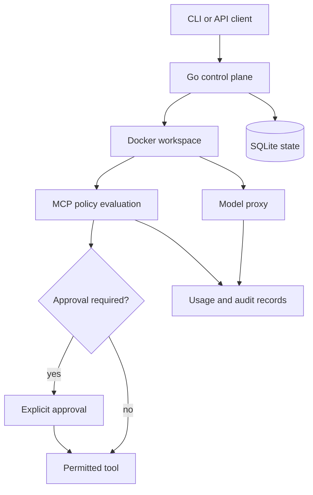

# Agent Workspace Manager

   [](LICENSE)

A Go control plane for running agent workloads in Docker workspaces, with model access and MCP policies managed outside the workload container.

Workspace lifecycle, provider access and tool approvals are different responsibilities here. The control plane coordinates them and retains local state and audit records, rather than giving every container an unrestricted copy of its configuration.

## What the control plane owns

- **Workspaces:** provision and operate Docker-backed environments through the CLI and control-plane API.
- **Model access:** route provider requests through the [LLM proxy](internal/llmproxy/proxy.go), where usage and access rules can be applied centrally.
- **Tools:** evaluate MCP server/tool rules and [argument path policies](internal/mcp/path_policy.go), including protected names and scoped overrides.
- **Records:** persist control-plane state in SQLite and record administrative activity through the audit package.



## Explore without provisioning a workspace

Use the toolchain declared in [go.mod](go.mod):

```console
go mod download
go test -count=1 ./...
go run ./cmd/stola version
go run ./cmd/stola
```

The last command displays usage. Workspace creation needs Docker and local configuration; it is not part of this inspection path.

## Configure one policy before scaling out

The [MCP policy example](examples/mcp-policy.example.yaml) includes approval rules for filesystem writes. Its action and reason fields include:

```yaml
action: require_approval
reason: nano users need explicit approval for filesystem writes
```

This is an excerpt, not a complete policy file. Server/tool matching, user plans and argument overrides are defined in the full example and [user configuration](examples/control-plane-users.example.yaml). Keep provider secrets out of manifests you share.

## Design and verification

[Docker workspace architecture](docs/architecture/docker-agent-workspaces.md) explains the implemented direction; [Docker-only scope](docs/adr/007-docker-only-no-os.md) distinguishes it from older appliance ideas. The [threat model](docs/architecture/threat-model.md) describes the intended boundaries.

The recorded offline run on 20 October 2026 passed all 12 Go packages containing tests. Mocked Docker runners, temporary stores and local HTTP servers exercise the control plane; this is not a real container-isolation certification or a production deployment result.

**Technology:** Go 1.25 · Docker · SQLite · YAML · HTTP proxy · MCP policy controls

Project-authored source: [MIT](LICENSE). Third-party components retain their own notices and terms.
