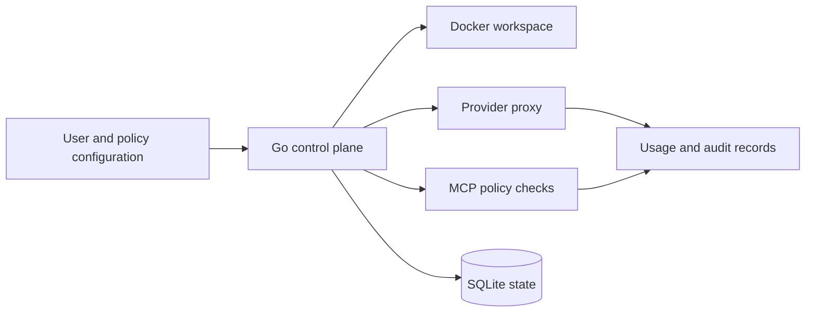

# Agent Workspace Manager

**Docker workspaces, controlled model access and inspectable agent operations.**

   [](LICENSE)

[Overview](#overview) · [Quickstart](#quickstart) · [Example](#example) · [Validation](#validation) · [Documentation](#documentation)

## Overview

A Go control plane for agent workspaces. It coordinates container lifecycle, local state, model-provider access and tool policies while keeping the control plane separate from the user workload. Policies and audit records make administrative decisions inspectable.

**Stack:** Go 1.25 · Docker · SQLite · YAML · HTTP proxy · MCP policy controls

## Control-plane responsibilities

| Component | Behavior |
| --- | --- |
| Workspace lifecycle | Create, inspect, start, stop and remove Docker-backed workspaces through explicit commands. |
| Provider proxy | Centralize provider access and usage controls outside user containers. |
| MCP policy | Apply tool and argument policies, including approval rules for selected actions. |
| Persistent operations | SQLite stores control-plane state; audit modules retain operational records. |

## Processing path



## Quickstart

```console
go mod download
go test -count=1 ./...
go run ./cmd/stola version
go run ./cmd/stola
```

Use the Go toolchain declared in go.mod or newer. The final command prints command usage without provisioning a workspace. Docker is needed for workspace integration, not for mocked unit-test runners.

## Example

**A policy that requires approval**

The [MCP policy example](examples/mcp-policy.example.yaml) defines scoped rules for filesystem tools. One rule requires approval for filesystem writes by a selected user plan.

```yaml
# Excerpt of the included policy; illustrative configuration.
action: require_approval
reason: nano users need explicit approval for filesystem writes
```

The full example also shows server/tool matching and argument-policy overrides. Use the [user configuration example](examples/control-plane-users.example.yaml) to understand identity and plan configuration.

## Configuration and storage

Configuration and policy are YAML; local state is SQLite. Provider secrets are separate inputs and must not be embedded in shared manifests. Workspace, proxy and policy commands are documented by the CLI; commands that provision or mutate containers require deliberate local configuration.

## Repository guide

| Location | Responsibility |
| --- | --- |
| [cmd/stola/main.go](cmd/stola/main.go) | CLI and command dispatch |
| [internal/controlplane](internal/controlplane) | Control-plane API |
| [internal/llmproxy](internal/llmproxy) | Provider proxy and access controls |
| [internal/mcp](internal/mcp) | MCP policy boundary |
| [internal/state](internal/state) | Persistent state |

## Validation

Go 1.27.3 on Windows: all 12 packages with tests passed. Tests use temporary stores, mocked Docker runners and local HTTP servers.

These are the last recorded offline checks (20 October 2026), not a new execution triggered by this documentation revision.

## Scope and operational boundaries

The implemented direction is a Docker workspace MVP. Earlier appliance/virtualization designs are historical context. Mocked tests do not establish real Docker provisioning, hosted isolation guarantees or production availability.

## Documentation

- [Docker workspace architecture](docs/architecture/docker-agent-workspaces.md)
- [Threat model](docs/architecture/threat-model.md)
- [Docker-only scope decision](docs/adr/007-docker-only-no-os.md)
- [Provider catalog decision](docs/adr/008-provider-catalog-litellm.md)

## License and attribution

Project-authored source code is licensed under the [MIT License](LICENSE). Third-party components and datasets retain their respective rights and licenses.
